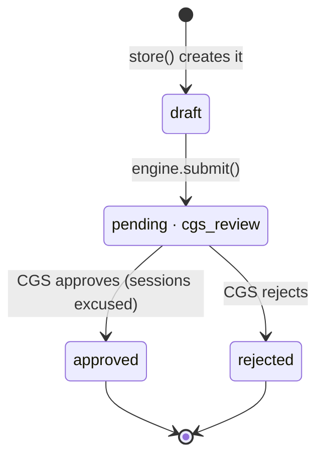
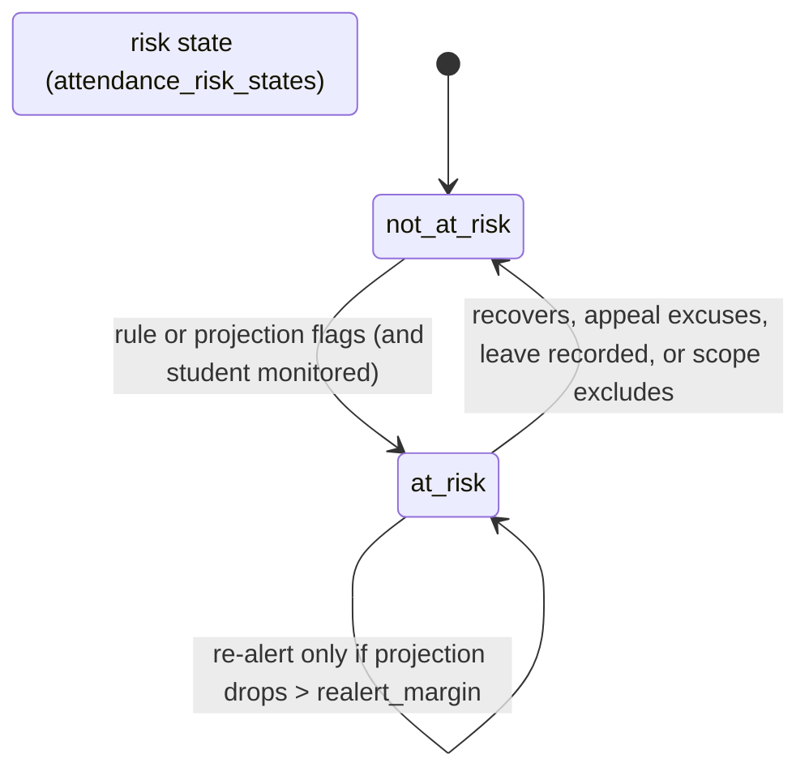
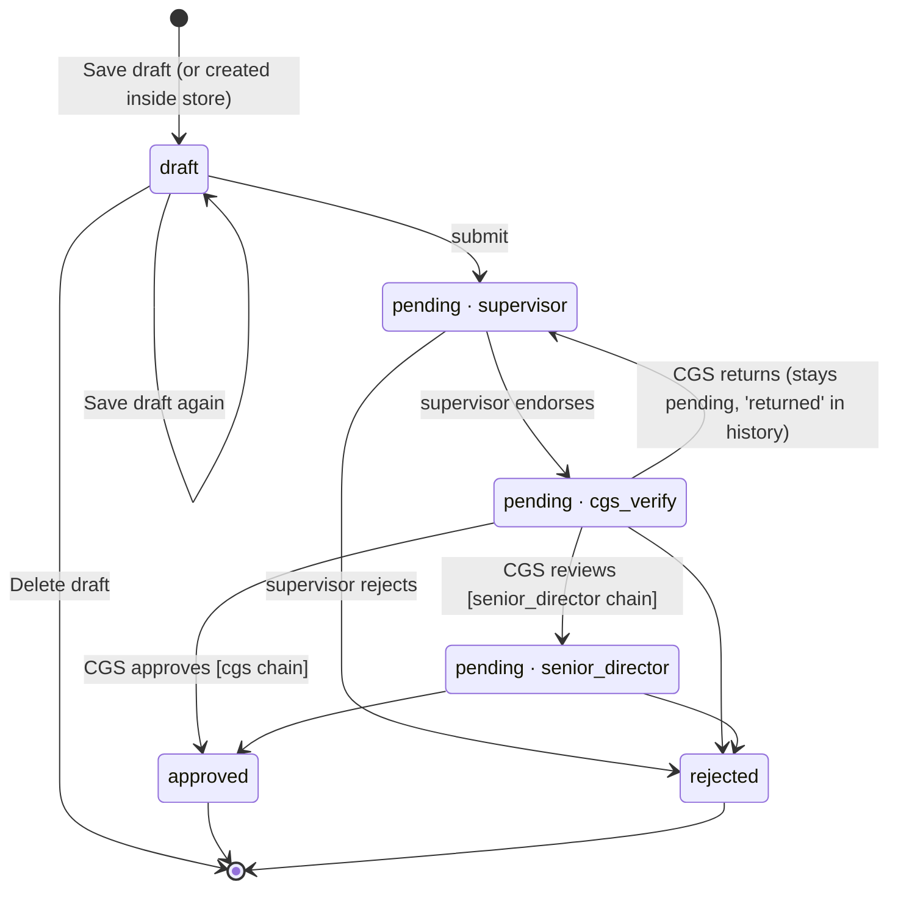
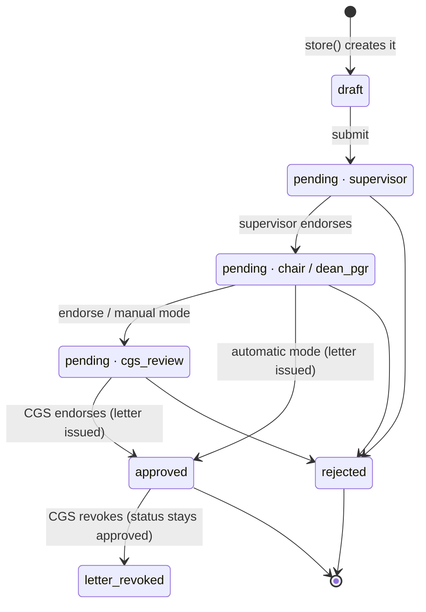

Last updated: 2026-11-03 · branch `nureen/forms-and-drafts` · commit `655b2a5`

# Nureen's modules: how they work today

A snapshot of Nureen Nellysha's four UResearch 2.0 modules (Attendance Record
with appeals, GA Extension, Supervision, GA/GRA Certification Letter), read
from the code. Paths are relative to the repo root; `N/` means
`app/Modules/Nureen/`. Config keys are `config('nureen.…')`; defaults are the
values the dev app loads. Anything not confirmed in code is marked
**UNVERIFIED**.

---

# 1. Stack & conventions

| | |
|---|---|
| Framework | Laravel 12, PHP 8.3 (`uresearch-app` container: PHP 8.3.33) |
| DB | MySQL 8.4 in Docker (`uresearch-mysql`) |
| Views | Blade; Core's form stepper (`core::partials.form-stepper`) on every multi-step form |
| PDFs | Dompdf via `barryvdh/laravel-dompdf`, all rendered by `N/Support/LetterRenderer.php` |
| Charts | Chart.js (`public/js`), used on dashboards and analytics |
| Spreadsheets | `maatwebsite/excel` for the attendance sheet (`N/Support/AttendanceSheet.php`) |
| Mail | Mailpit in dev; notifications are queued (`uresearch-queue` worker) |

**How the module plugs into Core**
- `N/ModuleProvider.php` merges `N/config/nureen.php` into `nureen`, binds Core's `SuppliesAttendance` to `N/Support/AttendanceProvider.php`, registers the four workflows with `ModuleRegistry`, registers the console commands and schedules three of them (§2).
- `N/routes.php` holds every route (all under `auth` except the ingest endpoint and the public verification pages).
- `N/Workflows/*Workflow.php` declare each chain as `Stage` objects (key, label, role, decision verb). Core builds queues, sidebar links, the tracking stepper and authorisation from them.
- **Core tables:** `applications` (status `draft|pending|approved|rejected|returned`, `current_stage`), `approval_history` (one row per decision: `endorsed|reviewed|approved|rejected|returned`), `application_documents`. Each module stores its own fields in a `*_details` table in `N/Database/Migrations/`.
- **`Core\Services\WorkflowEngine`** is the only writer of `status` and `current_stage`:
  - `submit()` moves a draft to the first stage and notifies nobody.
  - `decide()` handles approve/reject and emails the student `ApplicationDecided` after each decision.
  - `returnTo()` sends an application back to an earlier stage; it stays `pending` and the remarks are mandatory.

  The engine never emails the next approver, so Nureen's `N/Support/SubmissionNotifier.php` emails the first approver at submission.
- **`Core\Services\DocumentStore`:** `attachMany()` stores files on the private disk under random names; `storeGenerated()` stores generated letters as `application_documents`. Multi-file limits: 5 files, 5 MB each, 20 MB total, `pdf, jpg, jpeg, png, docx`. The certification overrides this to PDF only.
- **Ownership:** Nureen edits only `app/Modules/Nureen/` (plus `tests/Feature/Nureen/` and `docs/`). Anything needing Core goes in `N/SHARED_CHANGES.md` as a numbered section. Never push; commit only on a branch.
- **Cross-module pages in this folder:**
  - My Drafts: `N/Http/Controllers/DraftsController.php`.
  - Expected Decision Dates: `ExpectedDecisionController`.
  - Read-only staff view `/nureen/applications/{id}`: `StaffApplicationController` and `N/Support/StaffApplicationAccess.php`.
  - Stuck Reviews: `StuckReviewsController` and `N/Support/StuckSupervisorStages.php`.
  - Processing-time analytics: `AnalyticsController` and `N/Support/ProcessingTimeAnalytics.php`.
- **Client Charter:** `N/Support/ClientCharter.php` uses `charter_days` per stage, counted in working days (`N/Support/WorkingDayCalendar.php`, holidays from `charter.holidays` plus Core's `config/calendar.php`). It drives due dates, the overdue order of queues, reminders and analytics.

**Dev URLs** (`README.md`)

| What | URL | Login |
|---|---|---|
| App | http://localhost:8000 | any account below, password `password` |
| phpMyAdmin | http://localhost:8080 | `root` / `secret` |
| Mailpit | http://localhost:8025 | none |

**Test accounts used by these modules** (`docs/test-accounts.md`)

| Email | Role | Name | Dept |
|---|---|---|---|
| `student@utp.edu.my` | Student (recommended demo student, 22001001) | Ahmad Danial | Computing |
| `student2@utp.edu.my` | Student (22001002, "PhD Part-Time") | Nur Farah Adilah | Computing |
| `supervisor@utp.edu.my` | Supervisor | Dr. Aisyah Rahman | Computing |
| `chair@utp.edu.my` | Chair | Dr. Lim Wei Chun | Computing |
| `cgs@utp.edu.my` | Non-Executive CGS | M Syahmi Ifwat M Jafri | CGS |
| `director@utp.edu.my` | Senior Director CGS | En Zulkifly | CGS |
| `dean@utp.edu.my` | Dean of PGR | Prof. Dr. Hafiz Osman | PGR |

"CGS staff" in the code (`Role::isCgs()`, `app/Modules/Core/Support/Role.php`) means four roles: Non-Executive, Senior Executive, Manager and Senior Director CGS.

---

# 2. Modules

## 2.1 Attendance Record (with Attendance Appeal)

**Purpose.** UTrace attendance is imported per student per period. A student
is flagged when below 80%, when declining near 80%, or when projected to end
the semester below 80%; they and their supervisor are then emailed. Students
can appeal with evidence, and approved sessions are excused. Approved annual
leave is recorded and never counts as absence.

**Roles**

| Role | Sees / does |
|---|---|
| Student | Own overview and history (`/attendance/overview`, `/attendance/history`): current %, semester-so-far %, per-period sessions, excused and leave days. Never sees the projection or trend. The dashboard card (`AttendanceProvider::actionFor()`) shows "Attend N of next M", "Justification needed", the appeal status, or "Not monitored". Submits appeals. |
| Supervisor | A copy of each alert email. Core's supervisor dashboard reads `AttendanceProvider` (at-risk badges). |
| Non-Executive CGS | Upload the sheet; download the template; Sync now; At-Risk Students (projection, trend, reason, last emailed); Approved Leave page; decides appeals (may approve fewer sessions than requested). |
| External system | `POST /attendance/ingest` with an `X-Api-Key` header (`attendance.ingest_key`). |

No encrypted or masked fields.

**Workflow (appeal only)**: `N/Workflows/AttendanceAppealWorkflow.php`

| # | Key | Label | Actor | Charter days | Decision |
|---|---|---|---|---|---|
| 1 | `cgs_review` | Non-Executive CGS | `non_exec_cgs` | none configured | `approved` / `rejected` (final) |

No variants. Submission emails every Non-Executive CGS account (`SubmissionNotifier`).

**State machines**

The draft exists only inside the `store()` transaction; appeals have no
saved drafts. `returned` and revoked don't apply.

**Form fields (appeal)**: `N/Http/Controllers/AttendanceAppealController.php::store()`

| Label | Required on submit | Stored |
|---|---|---|
| Attendance period (`attendance_record_id`) | no; must be the student's own (403 otherwise) | `attendance_appeal_details.attendance_record_id` |
| Sessions requested | when a period is chosen; ≤ that period's `sessionsMissed()` | `.sessions_requested` |
| Reason | yes, 20–2000 chars | `.reason` |
| Justification Letter | yes, multi-file | document `Justification Letter` |
| Monthly Activity Breakdown | yes, multi-file | document `Monthly Activity Breakdown` |
| Other supporting document | no, single file (`DocumentStore::rules()`: 10 MB, pdf/jpg/png/doc(x)/xls(x)) | document `Supporting Document` |

Required documents: `attendance_appeal.required_documents`. CGS's decision
stores `sessions_approved` (≤ requested; blank means the number requested) and
adds it to `attendance_records.sessions_excused`, capped at `sessionsMissed()`,
then re-flags all the student's periods.

**Attendance data** (`attendance_records`): `period_end`,
`sessions_attended`, `sessions_total`, `sessions_excused`, `leave_days`,
`percentage` (always recomputed on save), `at_risk`. One row per student per
period, upserted by `AttendanceRecord::recordPeriod()` (`N/Models/AttendanceRecord.php`).

**Drafts:** none.

**Automation**

| What | How | Config (default) | Warn / block |
|---|---|---|---|
| Ingestion | `N/Support/AttendanceIngestor.php` is the one rule set for every path: known student by matric, real date, `period_end` not in the future, `0 ≤ attended ≤ total`, `total > 0`, optional `leave_days` (whole number ≥ 0, `attended + leave ≤ total`). Bad rows are skipped with a reason; good rows save. | | blocks the row |
| Sources | `attendance:sync` (`N/Console/Commands/SyncAttendance.php`, scheduled daily 02:00) pulls from `inbox` (`N/Support/AttendanceSources/InboxFolderSource.php`: files moved to processed/failed), `api` (`PushEndpointSource`, rows staged by `POST /attendance/ingest`), or `simulated`. CGS can also upload manually, or press Sync now. | `attendance.source` (`inbox`), `attendance.inbox_path`, `attendance.ingest_key` (null, which refuses every request) | |
| Sheet | Header must start `matric_no, period_end, sessions_attended, sessions_total`; an optional 5th column `leave_days` is read only if its header says so. The template download stays at four columns. Dates: Excel serial, `Y-m-d`, `d/m/Y` preferred. | | |
| Rule | Below 80%, or 3 declining periods ending ≤ 85% (`AttendanceRiskEvaluator::THRESHOLD = 80`, `EARLY_WARNING_BAND = 5`, constants in `N/Support/AttendanceRiskEvaluator.php`). | | warn (email) |
| Projection | Least-squares line over the semester's periods (`N/Support/AttendanceProjector.php`) to `semester_periods`. Flags when projected < 80% and periods so far are between `projection_min_periods_to_flag` and `projection_active_until × semester_periods`. Shown to CGS only. | `semester_periods` (14), `semester_start` (`2026-10-05`), `projection_min_periods` (3), `projection_min_periods_to_flag` (4), `projection_active_until` (0.6) | warn |
| Early warning | `N/Support/AttendanceEarlyWarning.php` runs after every sync and upload. It writes `attendance_risk_states`, emails on becoming at-risk, re-alerts only if the projection fell by more than the margin, and logs `attendance_alerts`. | `realert_margin` (5.0) | |
| Excused sessions | Counted as attended, `(attended+excused+leave)/total`, or removed from the total. | `excused_sessions` (`count_as_attended`), **pending CGS** | |
| Scope | Who is monitored: `N/Support/AttendanceScope.php`, using `N/Support/StudyProfile.php`. Under `full_time_research`, only full-time research students are flagged or alerted; unknown students follow `scope_unknown`. Out-of-scope: stale flags cleared, the dashboard card says "Not monitored". | `scope` (`all`), `scope_unknown` (`include`) | |
| Annual leave | `leave_days` per period, set by CGS on `/attendance/leave` (period must be on file; ≤ missed sessions not already excused) or by the sheet column (a blank keeps the recorded value). Counted like excused sessions. `N/Support/AttendanceLeave.php` sums by semester (period-end month) and year. | `leave.annual_days` (14), `leave.semesters` (Jan 5 / May 4 / Sep 5; months 1–4 / 5–8 / 9–12), `leave.sessions_per_day` (1) | warn CGS after the upload or record, on the leave page and the At-Risk banner; days still count |
| Backtest | `php artisan attendance:backtest` (`N/Console/Commands/BacktestAttendance.php`, `N/Support/Backtest/`) measures the projection's accuracy; writes nothing. | | |
| Check only | `attendance:check-risk` (`CheckAttendanceRisk.php`, not scheduled) runs the early warning without a sync. | | |

**Notifications**

| Trigger | Notification | Recipient |
|---|---|---|
| Newly at risk, or projection dropped > margin | `AttendanceAtRisk` (no projected figure; states that the allowance may be suspended, registration barred, and visa renewal unsupported) | student; copy to supervisor |
| Appeal submitted | `ApplicationAwaitingYou` | every `non_exec_cgs` |
| Appeal decided | Core `ApplicationDecided` | student |

**Key routes**

| Method | URI | Purpose |
|---|---|---|
| GET | `/attendance/overview`, `/attendance/history` | student pages |
| GET/POST | `/attendance/upload` | CGS upload form / ingest |
| GET | `/attendance/template` | blank sheet (`?format=csv`, else xlsx) |
| POST | `/attendance/sync-now` | run `attendance:sync` |
| GET | `/attendance/at-risk` | CGS predictive list and leave banner |
| GET/POST | `/attendance/leave` | Approved Leave page / record leave |
| POST | `/attendance/ingest` | API staging (throttle 60/min, `X-Api-Key`) |
| GET/POST | `/attendance-appeal/new`, `/attendance-appeal` | appeal form / submit |
| GET | `/attendance-appeal/queue` | CGS queue |
| POST | `/attendance-appeal/{application}/decide` | decide |

**Key files:**
- Controllers: `N/Http/Controllers/AttendanceController.php`, `AttendanceAppealController.php`, `AttendanceIngestController.php`.
- Models: `N/Models/AttendanceRecord.php`, `AttendanceRiskState.php`, `AttendanceAlert.php`, `AttendanceAppealDetail.php`, `AttendanceSyncRun.php`, `AttendanceIngestQueueEntry.php`.
- Support: `AttendanceIngestor`, `AttendanceSheet`, `AttendanceSyncRunner`, `AttendanceSourceFactory`, `AttendanceRiskEvaluator`, `AttendanceProjector`, `AttendanceEarlyWarning`, `AttendanceTarget`, `AttendanceProvider`, `AttendanceScope`, `StudyProfile`, `AttendanceLeave`.
- Views: `N/Resources/views/attendance/*`, `attendance_appeal/*`.
- Notification: `N/Notifications/AttendanceAtRisk.php`.

**Tests** (`tests/Feature/Nureen/`)

| File | Covers |
|---|---|
| `AttendanceTest` | template round-trip, header check, Excel date formats, bad rows skipped, re-upload replaces, at-risk on transition |
| `AttendanceSyncTest` | inbox and simulated sources, idempotent sync, bad header to failed, risk check after sync, Sync now |
| `AttendanceIngestEndpointTest` | API key required, staging without immediate ingest, sync consumes staged rows |
| `AttendanceDataRulesTest` | no future periods, mixed period lengths, demo semester, appeal documents, approved < requested, excused-session rule |
| `AttendanceProjectorTest` | least-squares maths, too few periods, zero-session periods, clamping |
| `AttendanceProjectionWindowTest` | flag window boundaries; backtest replay matches live `assess()` |
| `AttendanceEarlyWarningTest` | who is flagged and why, wording without projection, no repeats, re-alert margin, CGS list |
| `AttendanceActionCardTest` | N-of-M arithmetic, card states, appeal status on card |
| `AttendanceBacktestTest` | backtest metrics, `--runs`, `--compare`, no DB writes |
| `AttendanceAppealTest` | single final stage; can't appeal another student's record |
| `AttendanceHandbookTest` | `StudyProfile`, scope both ways, `scope_unknown`, leave counting both rules, leave through every path, CGS leave page, allowance warnings, alert consequences wording |

## 2.2 GA Extension

**Purpose.** A Graduate Assistant asks to extend their appointment. The
student enters everything on CGS's official GA Extension Form (UTP/CGS/001-A2),
attaches the checklist documents, and the system generates the form as a PDF.
The named supervisor endorses, then CGS decides; in the older chain the Senior
Director gives the final approval. System checks show the Terms & Conditions
and Handbook rules.

**Roles**

| Role | Sees / does |
|---|---|
| Student | Fill, save drafts, submit; download the generated form at any time (draft included), masked; list of own applications with PDF links on `/ga-extension/new`. |
| Supervisor (named one only) | Queue at `supervisor` (only applications where `ga_extension_details.supervisor_id` is them); endorse or reject; download the PDF. Sees account and IC numbers masked. |
| Non-Executive CGS | Queue at `cgs_verify`; full account and IC numbers (`GaExtensionDetail::revealsSensitiveTo()`: only the `cgs_verify` stage's role); fills Section J; approve, reject, or send back to the supervisor (remarks required). |
| Senior Director CGS | `senior_director` chain: final approve or reject. `cgs` chain: emailed every outcome for information. Can open the staff read-only view of GA Extensions. Sees numbers masked. |
| Others | 403 on the PDF (`GaExtensionController::canViewForm()`). |

Encrypted (`encrypted` cast, `N/Models/GaExtensionDetail.php`):
`bank_account_no` and `identity_number`, shown as `•••• 1234` outside the CGS
stage and never redisplayed on the form ("On file … Leave blank to keep it").

**Workflow**: `N/Workflows/GaExtensionWorkflow.php`. The chain is fixed per
application by `ga_extension_details.final_approver_snapshot`.

`final_approver = cgs` (**default**):

| # | Key | Label | Actor | Charter days | Decision |
|---|---|---|---|---|---|
| 1 | `supervisor` | Lecturer/Supervisor | named `supervisor` | 3 | `endorsed` / rejected |
| 2 | `cgs_verify` | Non-Executive CGS | `non_exec_cgs` | 2 | `approved` (final) / rejected / return to the supervisor |

`final_approver = senior_director` (the older chain):

| # | Key | Label | Actor | Charter days | Decision |
|---|---|---|---|---|---|
| 1 | `supervisor` | Lecturer/Supervisor | named supervisor | 3 | `endorsed` |
| 2 | `cgs_verify` | CGS Staff | `non_exec_cgs` | 2 | `reviewed` / return |
| 3 | `senior_director` | Senior Director CGS | `senior_director_cgs` | none (`stalled_days` 3 fallback) | `approved` |

`stages(null)` returns the superset of both chains, so the queues for both stay reachable.

Status `returned` (return to the student) is never reached: `decide()` accepts
only approve or reject. Nothing is revoked.

**Form fields**: `N/Resources/views/ga_extension/form.blade.php`; validation in
`GaExtensionController::store()`, `applicantRules()`, `publicationRules()`.
Steps: Your details → Identity & bank → Extension details → Publications →
(Additional information) → Supporting documents → Declaration → Review.

| Label | Required on submit | Stored (`ga_extension_details`) | Encrypted |
|---|---|---|---|
| Name, Student ID, Programme, Supervisor | from profile, read-only, never read from the request | `users` | no |
| Mode of study (Full-time / Full-time ODL / Part-time) | yes | `mode_of_study` | no |
| Programme type (Research / Coursework) | yes | `study_type` | no |
| Admission date (≤ today) | yes | `admission_date` | no |
| Period of candidature (≤ 60) | yes | `candidature_period` | no |
| Level of study (MSc / PhD) | yes; must be in `allowed_levels` (**blocks**) | `level_of_study` | no |
| Contact no., Email | yes | `contact_no`, `contact_email` | no |
| Name of bank, Account no. | yes while `collect_bank_details`; otherwise not asked or stored | `bank_name`, `bank_account_no` | account: yes |
| IC no. or passport no. | yes (unless on file) | `identity_number` | yes |
| Hold a student visa? / Visa expiry date | yes / only if yes (cleared if no) | `holds_visa`, `visa_expiry_date` | no |
| Current GA end date; requested new end date (after current); reason (20–2000) | yes | `current_end_date`, `requested_new_end_date`, `reason_for_extension` | no |
| Publications (≤ 10 rows): type, status (Accepted/Published), authors, year, title, venue required per row; volume, pages, DOI, ISSN (`1234-5678`), database, quartile, impact factor optional | rows optional; blank rows dropped | `publications` (JSON) | no |
| Declaration (form's wording, `ga_extension.declaration`) | yes (**blocks**) | `declaration_accepted_at` | no |
| Additional fields | from `additional_fields` (empty) | `additional_info` (JSON) | no |

Also stored: `supervisor_id` and `final_approver_snapshot` (both at submit),
`draft_step`, `cgs_remarks` (JSON), `cgs_remarks_by_id`, `cgs_remarks_at`.

**Documents** (5 files, 5 MB each, 20 MB per type):
- Required (`ga_extension.required_documents`): IC or Passport/Visa Copy, Admission Letter & Offer Letter, Supervisor's Supporting Letter.
- Optional stage-gate proofs (`stage_gate_documents`): Proof of Journal Article Acceptance, Published Journal Article (front page), Proof of Soft Bound Submission.
- Legacy types, shown only on older applications (`legacy_documents`): GA Extension Form, Acceptance Letter or Published Paper.

**Other blocks on submit:**
- A backdated start (the current end date + 1 day is before today).
- No actionable supervisor (`N/Support/SupervisorCheck.php`): none assigned, or the one on record lacks the Supervisor role.

**Drafts** (`N/Support/Drafts.php`, `DraftsController`): Save draft creates
an `applications` row with status `draft` plus the detail row.
- **Saving:** light validation only (types and lengths; never required, never the declaration). Files attach immediately, and ticked "Remove" boxes delete files. `draft_step` reopens the step the student was on.
- **Continuing:** from `/ga-extension/draft/{id}` or My Drafts (`/my-drafts`).
- **Submitting:** reuses the row under lock (409 if already submitted), with full validation; files already attached satisfy "required".
- **Deleting:** removes the files, the detail row and the application.
- **Access:** only the owner (`Drafts::ownedBy()`: 403 for others, 404 if not a draft). Drafts never reach queues, reminders or analytics.
- **"Download the form (PDF)"** saves the draft, then downloads it automatically.

**Automation: System checks** (`N/Resources/views/ga_extension/_detail.blade.php`,
`N/Support/GaExtensionRules.php`). All checks are pass, fail or unknown; they
warn and never block.

| Check | Rule | Config (default) |
|---|---|---|
| Documents | each required type present; stage-gate and legacy types listed | `required_documents`, `stage_gate_documents`, `legacy_documents` |
| Full-time research student | mode ∈ full_time and type ∈ research | `eligible` (`full_time`, `research`) |
| Total GA duration | admission → new end ≤ 24 (MSc) / 42 (PhD) months | `rules.max_months` |
| Within the candidacy period | new end ≤ admission + 4 (MSc) / 8 (PhD) years − 1 day | `rules.max_candidacy_years` |
| Extension length | 3–12 months (start = current end + 1 day) | `rules.extension_months` |
| Start day | 1st or 16th | `rules.start_days` ([1,16]) |
| End day | 15th or last day of the month | `rules.end_days` ([15,'last']) |
| Submitted early enough | submitted ≥ 1 month before the start (drafts judged as of today) | `rules.notice_months` (1) |
| Stage gate proof | level = highest gate whose `from` ≤ whole months since admission at the start (a boundary month belongs to the later level); proof per level; Level 1 (RPD) needs none | `rules.stage_gates` (MSc 3/12/18; PhD 6/18/30/36) |
| PhD Level 3 | either (1) a published Q1/Q2 WoS journal article + published proof, or (2) one accepted + one published WoS/ERA/Scopus journal article + both proofs; reports which option passed or what each lacks | `rules.phd_level3` |

**Generated PDF**: `LetterRenderer::gaExtensionForm()`, view
`N/Resources/views/letters/ga_extension_form.blade.php`. A4, two pages, page
numbers stamped on the canvas, rendered fresh on every download (not stored).

| Section | Filled from |
|---|---|
| A Checklist | items 1–3: a student tick if a document of that type is attached; item 4: any stage-gate or legacy proof; CGS column ticked once the latest `cgs_verify` decision after the last return passed |
| B GA details | profile + detail row; account and IC masked by viewer; bank blank when `collect_bank_details` is false; "Extension of GA duration" computed |
| C Publications | `publications` rows (at least 3 rows printed) |
| D Declaration | "Declared electronically", name, date from `declaration_accepted_at` |
| E Endorsements | name, role and date of the latest supervisor / `cgs_verify` / `senior_director` decision after the latest `returned` row; blank if not yet reached or not on this chain |
| J CGS remarks | `cgs_remarks` (8 fields, `cgs_remarks_fields`), saved by CGS at `cgs_verify` |
| Footer | generated time, application id, status (e.g. "Pending: Non-Executive CGS") |

The PDF doesn't reproduce the form's Terms & Conditions pages. No reference
number or QR.

**Reminders:** `ga-extension:remind-stalled` (daily 08:00) runs once a stage
is past its charter days (`stalled_days` 3 as the fallback) and repeats every
threshold working days. It goes to the named supervisor, or the stage's role
holders.

**Notifications**

| Trigger | Notification | Recipient |
|---|---|---|
| Submitted | `ApplicationAwaitingYou` (with charter due date) | named supervisor |
| Each decision | Core `ApplicationDecided` | student |
| CGS returns | Core `ApplicationReturned` | student and every Supervisor-role user (Core behaviour, SHARED §6a) |
| Final decision | `GaExtensionFinalDecisionCc` | supervisor who endorsed |
| Final decision, `cgs` chain | `GaExtensionFinalDecisionInformational` | every Senior Director CGS |
| Stalled | `ApplicationStalled` | current stage's approver(s) |

**Key routes**

| Method | URI | Purpose |
|---|---|---|
| GET | `/ga-extension/new` | form + own submitted list |
| POST | `/ga-extension` | submit |
| POST/GET/POST/DELETE | `/ga-extension/draft[/{id}]` | save / continue / update / delete draft |
| GET | `/ga-extension/queue` | approver queue |
| POST | `/ga-extension/{id}/decide` | approve / reject |
| POST | `/ga-extension/{id}/return` | CGS sends back to supervisor |
| POST | `/ga-extension/{id}/cgs-remarks` | Section J (non_exec_cgs at `cgs_verify` only) |
| GET | `/ga-extension/{id}/form` | generated PDF (owner, or approvers on its chain) |

**Key files:** `N/Http/Controllers/GaExtensionController.php`,
`N/Workflows/GaExtensionWorkflow.php`, `N/Models/GaExtensionDetail.php`,
`N/Support/GaExtensionRules.php`, `N/Support/LetterRenderer.php`,
`N/Support/Drafts.php`, views `N/Resources/views/ga_extension/{form,_detail,_field,_publication_row,queue}.blade.php`,
`letters/ga_extension_form.blade.php`, `N/Console/Commands/RemindStalledGaExtension.php`.

**Tests**

| File | Covers |
|---|---|
| `GaExtensionTest` | document completeness, file limits, both chains step by step, return to the supervisor |
| `GaExtensionFormTest` | Section B storage, profile not overridable, visa, declaration, backdated block, encryption and masking, bank flag, publications JSON, Section A/E/J, PDF access, legacy applications |
| `GaExtensionRulesTest` | each T&C check pass/fail for MSc and PhD, stage-gate boundary months, legacy proof, config-driven |
| `GaExtensionHandbookTest` | eligibility, candidacy limit, PhD Level 3 both options, `allowed_levels` both ways, publication status required |
| `DraftsTest` | drafts for both modules (save, continue, remove, submit, delete, ownership, invisible to queues) |
| `SnapshotChainReachabilityTest` | both chains reachable after config flips; named-supervisor gating |

## 2.3 Supervision (supervisor appointment)

**Purpose.** A student asks for a Main Supervisor or Co-Supervisor. The
requested supervisor endorses, then the Chair of Department (or the Dean of
PGR for Co-Supervisors, if configured). CGS then endorses, which issues an
appointment letter with a verifiable reference. Approving a Main Supervisor
request changes `users.supervisor_id`; revoking the letter can restore the
previous one.

**Roles**

| Role | Sees / does |
|---|---|
| Student | Submit a request (no drafts). If it's a change of Main Supervisor and no GA appointment is on record, declares whether they are a GA; uploads the PGFAC memo when required. |
| Requested supervisor | Queue at `supervisor` (only requests naming them); endorse or reject (reject needs remarks). |
| Chair (own department) | Queue at `chair` (department-scoped by Core). |
| Dean of PGR | Queue at `dean_pgr` (Co-Supervisor requests only, when `co_supervisor_approver = dean_pgr`). |
| Non-Executive CGS | `cgs_review`: preview the letter (DRAFT), endorse and issue it; Issued Appointment Letters list; download and revoke letters; Stuck Reviews. |

No encrypted fields.

**Workflow**: `N/Workflows/SupervisionWorkflow.php`. Two snapshots per
application: `cgs_stage_snapshot` (from `supervision.cgs_stage`) and
`co_supervisor_approver_snapshot` (from `supervision.co_supervisor_approver`;
used only when `appointment_role = co_supervisor`; Main requests always go to
the Chair).

| `cgs_stage` | Stages (key: actor, charter days, decision) |
|---|---|
| `endorse` (**default**) | `supervisor`: requested supervisor, 3, endorsed → `chair` (Chair, 3) **or** `dean_pgr` (Dean of PGR, 3), endorsed → `cgs_review`: Non-Exec CGS, 0, `endorsed`, which issues the letter and approves |
| `manual` | supervisor → chair/dean_pgr (endorsed) → `cgs_review`: CGS, 0, `approved` (eligibility review), which issues the letter |
| `automatic` | supervisor → chair/dean_pgr, `approved` (final), which issues the letter naming no CGS endorser ("following approval by the Chair of Department / Dean of PGR, <name>") |

`co_supervisor_approver`: `chair` (**default**) or `dean_pgr`. The Dean's
stage appears in the superset only while the switch is on or a request
waits there.

No saved drafts. No return in this module; status `returned` is never reached.

**Form fields**: `N/Resources/views/supervision/form.blade.php`, `SupervisionController::store()`

| Label | Required | Stored (`supervision_details`) |
|---|---|---|
| Appointment role (Main / Co-Supervisor) | yes | `appointment_role` |
| Appointment type (New / Existing) | yes | `appointment_type` |
| Requested supervisor (Supervisor role; for Co: not the current main or an active co) | yes | `requested_supervisor_id` |
| Justification (20–2000) | yes | `justification` |
| Are you currently a GA? | only for a change of Main Supervisor with no `GaAppointmentRecord` | `is_ga`, `ga_status_source = declared` |
| Supporting Documents | yes, multi-file | document `Supporting Document` |
| PGFAC Approval Memo | yes when a change of Main Supervisor and a GA (**blocks**) | document `PGFAC Approval Memo` |

Snapshotted at submit:
- `is_change_of_supervisor`: a Main request while another supervisor is on record.
- `is_ga` / `ga_status_source`:
  - `record` means an active `GaAppointmentRecord` of a type in `pgfac_memo.ga_types` (`['GA']`) covers today (`N/Support/GaStatus.php`);
  - `declared` means taken from the form.
- `cgs_stage_snapshot`, `co_supervisor_approver_snapshot`.

On final approval of a Main request: `previous_supervisor_id` is saved, then
`users.supervisor_id` is set to the requested supervisor.

**Drafts:** none. Supervision doesn't call `SupervisorCheck`, because the
request itself names the supervisor; only GA Extension and Certification do
(`SupervisorSafeguardsTest` covers those two).

**Automation**

| What | Detail |
|---|---|
| System checks (`supervision/_detail.blade.php`) | change of supervisor or not; GA status and its source; PGFAC memo ✓/✗ when needed, otherwise "Not needed"; the Co-Supervisor approver; "Submitted before these were recorded" for old rows |
| Letter | `LetterRenderer::appointment()`, view `letters/appointment.blade.php` on the shared `letters/layout.blade.php`. Reference `CGS/SVAPPT/<year>/<NNNN>` (`N/Support/AppointmentReferenceGenerator.php`, row-locked); stored as document `Supervisor Appointment Letter`. Signatory: the CGS endorser (endorse/manual), or none (automatic). CGS preview = DRAFT watermark, nothing written. |
| Verification | public `GET /verify/appointment/{reference}` (throttle 30/min): Valid / Revoked with four public facts; the revocation reason is never shown. QR: none. `GeneratesQrCode` is bound to `UnavailableQrCodeGenerator`, which returns null, so the letter prints only the URL (SHARED §3). |
| Revoke | reason required. Sets `letter_revoked_at`/`reason` and re-renders the stored letter with REVOKED. Main role: restores `previous_supervisor_id` if the student's supervisor is still the appointed one, otherwise leaves it and notes why. |
| Reminders | `supervision:remind-stalled` (daily 08:00, `routes/console.php`) after `charter_days` (`reminders.supervision.stalled_days` 3 fallback). Recipients: requested supervisor / department Chairs / all Deans / all CGS. |
| Escalation | after `reminders.supervision.escalate_after_reminders` (2) reminders at `supervisor`, `chair` or `dean_pgr`: `SupervisionEscalatedToCgs` to every Non-Exec CGS |
| Stuck Reviews | `/reviews/stuck` lists requests no account can act on (`N/Support/StuckSupervisorStages.php`); Supervision requests can't be reassigned |

**Notifications**

| Trigger | Notification | Recipient |
|---|---|---|
| Submitted | `ApplicationAwaitingYou` | requested supervisor |
| Each decision | Core `ApplicationDecided` | student |
| Final approve or reject | `SupervisionFinalDecisionCc` | requested supervisor |
| Letter issued | `AppointmentLetterIssued` | student and appointed supervisor |
| Letter issued | `AppointmentLetterIssuedToCgs` | every Non-Exec CGS |
| Letter revoked | `AppointmentLetterRevoked` (quotes the reason) | student and requested supervisor |
| Stalled | `SupervisionRequestStalled` | current stage's approver(s) |
| Escalated | `SupervisionEscalatedToCgs` | every Non-Exec CGS |

**Key routes**

| Method | URI | Purpose |
|---|---|---|
| GET/POST | `/supervision/new`, `/supervision` | form / submit |
| GET | `/supervision/queue` | queue (supervisor, chair, dean_pgr, non_exec_cgs) |
| POST | `/supervision/{id}/decide` | decide |
| GET | `/supervision/issued` | CGS list of letters |
| GET | `/supervision/{id}/letter`, `/letter/preview` | download / DRAFT preview (CGS) |
| POST | `/supervision/{id}/revoke` | revoke (CGS) |
| GET | `/verify/appointment/{reference}` | public check |

**Key files:** `N/Http/Controllers/SupervisionController.php`,
`N/Workflows/SupervisionWorkflow.php`, `N/Models/SupervisionDetail.php`,
`N/Models/GaAppointmentRecord.php`, `N/Support/GaStatus.php`,
`N/Support/AppointmentReferenceGenerator.php`, `N/Support/LetterRenderer.php`,
`N/Http/Controllers/CertificateVerificationController.php`,
`N/Console/Commands/RemindStalledSupervisionRequests.php`, views `supervision/*`, `letters/appointment.blade.php`.

**Tests**

| File | Covers |
|---|---|
| `SupervisionTest` | required document on the private disk, a supervisor sees only requests naming them, revocation restoring the previous supervisor |
| `SupervisionHandbookTest` | GA status from records, PGFAC memo only for a GA changing supervisor (record or declared), System checks, Chair vs Dean approver, snapshot survives a config flip, Dean named in automatic-mode letter |
| `LettersTest` | endorse / automatic / manual letters, signatories, preview writes nothing, REVOKED, public verification |
| `LetterWorstCaseTest` | every letter fits one A4 page at maximum field lengths |
| `StalledReminderTest` | reminders on charter breach, `stalled_days` fallback, escalation |
| `SupervisorSafeguardsTest` | submission blocked without an actionable supervisor, first approver emailed, Stuck Reviews and reassign |
| `EmailLinksTest` | every email's button opens for its recipient |

## 2.4 GA/GRA Certification Letter

**Purpose.** A current or former GA or GRA requests an official letter
certifying the appointment. The form follows CGS's online form. The named
supervisor endorses, CGS verifies, and the Senior Director's approval issues
a letter with a verifiable reference number. The student can download a
pre-filled course-owner attachment to get signed.

**Roles**

| Role | Sees / does |
|---|---|
| Student | Fill, save drafts, submit; download the pre-filled attachment (own applications only, draft included). |
| Supervisor (named) | Queue at `supervisor`; endorse or reject; sees the identity number masked. |
| Non-Executive CGS | Queue at `cgs_verify`; sees the identity number in full; eligibility warning; Issued Certificates list; revoke. |
| Senior Director CGS | Queue at `senior_director`; Preview letter (DRAFT, own name); approving issues the letter. |
| Any CGS staff (4 roles) | Full identity number (`GaCertificationDetail::identityFor()` uses `isCgs()`). |

Encrypted: `ga_certification_details.identity_number`, masked as
`•••• 1234` for non-CGS and never redisplayed on the form.

**Workflow**: `N/Workflows/CertificationLetterWorkflow.php`. No variants.

| # | Key | Label | Actor | Charter days | Decision |
|---|---|---|---|---|---|
| 1 | `supervisor` | Lecturer/Supervisor | named supervisor | 3 | `endorsed` |
| 2 | `cgs_verify` | CGS Staff | `non_exec_cgs` | 2 | `reviewed` |
| 3 | `senior_director` | Senior Director CGS | `senior_director_cgs` | 2 | `approved`, which issues the letter |

```mermaid
stateDiagram-v2
    [*] --> draft : Save draft (or created inside store)
    draft --> draft : Save draft again
    draft --> [*] : Delete draft
    state "pending · supervisor" as P1
    state "pending · cgs_verify" as P2
    state "pending · senior_director" as P3
    draft --> P1 : submit
    P1 --> P2 : endorsed
    P2 --> P3 : reviewed
    P3 --> approved : approved (reference + letter)
    P1 --> rejected
    P2 --> rejected
    P3 --> rejected
    approved --> revoked : revoke (status stays approved; revoked_at set)
    approved --> [*]
    rejected --> [*]
```

No return path; status `returned` is never reached.

**Form fields**: `N/Resources/views/ga_certification/form.blade.php`,
`CertificationController::store()`, `onlineFormRules()`. Steps: Student
details → Application type → GA/GRA details → Supporting details → Approval &
notification → Agreement → Review.

| Label | Required on submit | Stored (`ga_certification_details`) | Encrypted |
|---|---|---|---|
| Matric, Name, Department, Programme | profile, read-only | `users` | no |
| Level (Coursework/Research), Level of Study (Master/PhD), Mode (Full-time/Full-time ODL/Part-time) | yes (`options`) | `study_level`, `level_of_study`, `mode_of_study` | no |
| Reason/Purpose (≤ 120) | no | `purpose` | no |
| Type (GA/GRA) | yes | `appointment_type` | no |
| Period start / end | only while `ask_period` (default true); otherwise hidden, not validated, not stored, not printed | `period_start`, `period_end` | no |
| GA: Course Code (20), Course Name (120), Course Owner (80), Semester (30) | yes | same names | no |
| GRA: Project Title (150), Project Leader (80), Semester (30), Grant/Project Code (40, optional) | yes except grant code | same names | no |
| MyKad/Passport no. (≤ 30) | yes unless on file | `identity_number` | yes |
| Evidence of Work Done (signed by Course Owner / Project Leader) | yes, PDF only (`supporting_document_types`) | document (label per type) | — |
| Personal email (≤ 150) | yes | `personal_email` | no |
| Supervisor email | shown from profile | `supervisor_id` (snapshot) | no |
| Declaration (`ga_certification.declaration`) | yes (**blocks**) | `declaration_accepted_at` | no |

Also: `draft_step`, `reference_number`, `revoked_at`, `revoked_reason`.
Submission is blocked without an actionable supervisor (`SupervisorCheck`).

**Drafts:** same mechanism as GA Extension (`N/Support/Drafts.php`). Switching
GA↔GRA relabels the attached files. "Download pre-filled attachment" saves
the draft, then downloads automatically.

**Automation**

| What | Detail | Config (default) | Warn / block |
|---|---|---|---|
| Eligibility (System checks, `_detail.blade.php`) | Research + Full-time passes; anything else ✗ "a former GA may still legitimately need a letter"; unknown for old rows. A matching note appears on the form. | `eligible` (`study_level` research, `mode_of_study` full_time) | warn |
| Appointment check | checks a `GaAppointmentRecord` of the type covers the period (or today) | `appointment_check_enabled` (false); not part of CGS's confirmed process | info only |
| Attachment PDF | `LetterRenderer::certificationAttachment()`, `letters/certification_attachment.blade.php`: name (matric), programme, today, first course row (GRA: grant code / project / leader), 4 blank rows; signature and stamp blank | — | — |
| Letter PDF | `LetterRenderer::certification()`, `letters/certification.blade.php`: subject, period (if `ask_period` and set) or "during the {semester} semester", details table + "Level of Study", purpose paragraph, Senior Director signatory, cc supervisor, verification URL. Stored as document `GA/GRA Certification Letter`. | `letters.*` | — |
| Reference | `CGS/GACERT/<year>/<NNNN>` (`N/Support/CertificateReferenceGenerator.php`) | `reference_prefix` | — |
| Verification | `GET /verify/certificate/{reference}`: Valid / Revoked; reason not public; no QR image (see Supervision) | — | — |
| Revoke | reason required; re-renders the stored letter with REVOKED; status unchanged | — | — |
| Reminders | `ga-certification:remind-stalled` (daily 08:00) | `reminders.ga_certification.stalled_days` (3) | — |

**Notifications**

| Trigger | Notification | Recipient |
|---|---|---|
| Submitted | `ApplicationAwaitingYou` | named supervisor |
| Each decision | Core `ApplicationDecided` | student |
| Approved | `CertificationIssued` (letter link) | student |
| Revoked | `CertificationRevoked` (quotes the reason) | student and supervisor |
| Stalled | `ApplicationStalled` | current stage's approver(s) |

**Key routes**

| Method | URI | Purpose |
|---|---|---|
| GET/POST | `/ga-certification/new`, `/ga-certification` | form / submit |
| POST/GET/POST/DELETE | `/ga-certification/draft[/{id}]` | drafts |
| GET | `/ga-certification/{id}/attachment` | pre-filled attachment (owner only) |
| GET | `/ga-certification/queue` | queue |
| POST | `/ga-certification/{id}/decide` | decide |
| GET | `/ga-certification/issued` | issued list with revoke forms |
| POST | `/ga-certification/{id}/revoke` | revoke (route roles: supervisor, non_exec_cgs, senior_director_cgs; see §4) |
| GET | `/ga-certification/{id}/letter/preview` | Senior Director DRAFT preview |
| GET | `/verify/certificate/{reference}` | public check |

**Key files:** `N/Http/Controllers/CertificationController.php`,
`N/Workflows/CertificationLetterWorkflow.php`, `N/Models/GaCertificationDetail.php`,
`N/Support/LetterRenderer.php`, `N/Support/CertificateReferenceGenerator.php`,
`N/Support/AppointmentVerifier.php`, `N/Console/Commands/RemindStalledCertification.php`,
views `ga_certification/*`, `letters/{certification,certification_attachment,layout,verify}.blade.php`,
`components/multi-file-upload.blade.php`.

**Tests**

| File | Covers |
|---|---|
| `CertificationTest` | type-specific fields, named supervisor, 3-stage chain, letter generated and emailed, appointment check on/off |
| `CertificationOnlineFormTest` | every online-form field, profile not overridable, PDF only, declaration, identity encrypted and masked, `ask_period` both ways, attachment access |
| `CertificationHandbookTest` | eligibility pass/fail/unknown, form note, warning to CGS without blocking |
| `CertificateVerificationTest` | reference format and sequence, public page, revoked state, issued list |
| `LettersTest`, `LetterWorstCaseTest` | letter content and one-page fit |

**Shared tests:** `ClientCharterTest`, `ClientCharterDisplayTest` (due dates,
expected decision page, overdue order); `WorkingDayCalendarTest`;
`AnalyticsTest`; `SeededDocumentsTest` (every seeded document is a valid PDF).

---

# 3. Configuration reference

Source: `N/config/nureen.php` (env name in brackets). "CGS?" = waiting on CGS
confirmation per the config comments or open questions.

| Key | Default | Effect | CGS? |
|---|---|---|---|
| `attendance.source` [`NUREEN_ATTENDANCE_SOURCE`] | `inbox` | sync source: inbox / api / simulated | no |
| `attendance.inbox_path` | `storage/app/attendance-inbox` | inbox folder | no |
| `attendance.ingest_key` [`…_INGEST_KEY`] | null | API key; null refuses all | no |
| `attendance.semester_periods` [`…_SEMESTER_PERIODS`] | 14 | periods per semester (projection length) | no |
| `attendance.semester_start` [`…_SEMESTER_START`] | `2026-10-05` | first day counted (demo semester) | set each semester |
| `attendance.excused_sessions` [`…_EXCUSED_SESSIONS`] | `count_as_attended` | how excused and leave sessions count | **yes** |
| `attendance.projection_min_periods` | 3 | fewer periods: no projection | no |
| `attendance.projection_min_periods_to_flag` [env] | 4 | earliest period the projection may flag | no (backtest-tuned) |
| `attendance.projection_active_until` [env] | 0.6 | latest share of the semester it may flag | no (backtest-tuned) |
| `attendance.realert_margin` | 5.0 | pp drop before re-alerting | no |
| `attendance.scope` [`…_SCOPE`] | `all` | `full_time_research` monitors only those students | waits on a Core `users` field (SHARED §16a) |
| `attendance.scope_unknown` [`…_SCOPE_UNKNOWN`] | `include` | unknown study profile under scope: include / exclude | no |
| `attendance.leave.annual_days` | 14 | annual leave allowance | no (handbook) |
| `attendance.leave.semesters` | Jan 5 (months 1–4), May 4 (5–8), Sep 5 (9–12) | per-semester caps | month mapping **UNVERIFIED** with CGS |
| `attendance.leave.sessions_per_day` | 1 | sessions per leave day | no |
| `attendance_appeal.required_documents` | Justification Letter, Monthly Activity Breakdown | required appeal uploads | no |
| `ga_extension.required_documents` | IC/Passport/Visa, Admission & Offer Letter, Supervisor's Letter | required uploads (checklist items 1–3) | no |
| `ga_extension.stage_gate_documents` | acceptance / published article / soft bound | optional proofs (item 4) | no |
| `ga_extension.legacy_documents` | GA Extension Form, Acceptance Letter or Published Paper | recognised on old applications | no |
| `ga_extension.applicant_fields` | 12 Section B fields (incl. `study_type`) | drives form, validation, storage | no |
| `ga_extension.allowed_levels` [`NUREEN_GA_EXTENSION_ALLOWED_LEVELS`] | `msc,phd` | `phd` only blocks MSc submissions | **yes** (handbook says PhD-only) |
| `ga_extension.eligible` | full_time + research | eligibility warning | no |
| `ga_extension.collect_bank_details` [`…_COLLECT_BANK_DETAILS`] | true | ask, store and print bank name + account | **yes** |
| `ga_extension.publications` | 10 rows; types, databases, quartiles, statuses | Section C | no |
| `ga_extension.declaration` | form's wording | Section D text | no |
| `ga_extension.cgs_remarks_fields` | 8 Section J fields | CGS remarks | no |
| `ga_extension.rules.max_months` | msc 24, phd 42 | total duration check | no |
| `ga_extension.rules.extension_months` | 3–12 | length check | no |
| `ga_extension.rules.start_days` / `end_days` | [1,16] / [15,'last'] | date checks | no |
| `ga_extension.rules.notice_months` | 1 | notice check | no |
| `ga_extension.rules.max_candidacy_years` | msc 4, phd 8 | candidacy check | no (handbook) |
| `ga_extension.rules.phd_level3` | wos; Q1,Q2; wos/era/scopus | PhD L3 options | no |
| `ga_extension.rules.stage_gates` | MSc 1/2/3 from 3/12/18; PhD 1–4 from 6/18/30/36 | stage-gate level and proof | boundary months **yes** |
| `ga_extension.additional_fields` | [] | extra fields → `additional_info` | no |
| `ga_extension.final_approver` [`…_FINAL_APPROVER`] | `cgs` | `senior_director` = 3-stage chain | no (confirmed) |
| `supervision.cgs_stage` [`NUREEN_SUPERVISION_CGS_STAGE`] | `endorse` | endorse / automatic / manual | no |
| `supervision.reference_prefix` | `CGS/SVAPPT` | letter reference | no |
| `supervision.co_supervisor_approver` [`…_CO_SUPERVISOR_APPROVER`] | `chair` | `dean_pgr` for Co-Supervisor requests | **yes** (handbook vs diagrams) |
| `supervision.pgfac_memo` | label "PGFAC Approval Memo", ga_types [GA] | memo requirement | no |
| `ga_certification.reference_prefix` | `CGS/GACERT` | letter reference | no |
| `ga_certification.appointment_check_enabled` [`…_APPOINTMENT_CHECK`] | false | automatic appointment check | **yes** (not in CGS's process) |
| `ga_certification.fields` | GA/GRA field sets with max lengths | type-specific fields | no |
| `ga_certification.purpose_max` | 120 | purpose length | no |
| `ga_certification.supporting_document_label` | per type | upload label | no |
| `ga_certification.options` | study_level / level_of_study / mode_of_study lists | selects | no |
| `ga_certification.ask_period` [`…_ASK_PERIOD`] | true | ask for and print the period | **yes** |
| `ga_certification.eligible` | research + full_time | eligibility warning | no |
| `ga_certification.declaration` | confirm-true-and-complete text | declaration | no |
| `ga_certification.supporting_document_types` | [pdf] | upload types | no |
| `reminders.supervision.stalled_days` / `escalate_after_reminders` | 3 / 2 | fallback days; escalation | no |
| `reminders.ga_extension.stalled_days`, `reminders.ga_certification.stalled_days` | 3 | fallback days | no |
| `charter_days.ga_extension` | supervisor 3, cgs_verify 2, senior_director null | Client Charter | no |
| `charter_days.supervision` | supervisor 3, chair 3, dean_pgr 3, cgs_review 0 | Client Charter | dean_pgr value **UNVERIFIED** |
| `charter_days.ga_certification` | supervisor 3, cgs_verify 2, senior_director 2 | Client Charter | no |
| `charter.holidays` | [] | extra non-working days | no |
| `letters.institution` / `centre` / `address` | UTP / CGS / Seri Iskandar | letterhead | no |
| `letters.phone` / `email` / `website` [env] | `+60 5-xxx xxxx` / `cgs@utp.edu.my` / `www.utp.edu.my` | letterhead | **yes** (placeholders) |
| `letters.logo_path` [`NUREEN_LETTER_LOGO`] | `public/images/UTP_logo.png` | logo (text letterhead if missing) | no |
| `letters.accent` | `#1F3A68` | letter colour | no |
| `letters.signatory_titles` | non_exec_cgs "Non-Executive", senior_director_cgs "Senior Director" | signature titles | **yes** (provisional) |

---

# 4. Open items

**Questions pending with CGS**
- **Period dates on the certification letter:** keep asking (`ask_period` true) or drop?
- **Bank details on the GA Extension Form:** does CGS already hold them? (`collect_bank_details`)
- **Stage-gate boundary months:** a boundary month counts as the later level (MSc month 18 → Level 3). Confirm.
- **Leave semester month mapping** (Jan–Apr / May–Aug / Sep–Dec): confirm.
- **MSc GA eligibility:** the July 2026 form allows MSc; the handbook says PhD-only (`allowed_levels`).
- **Co-Supervisor approver:** the Chair (CGS diagrams) or the Dean of PGR (handbook)?
- **Excused/leave counting:** count as attended, or exclude from the total? (`excused_sessions`)
- **Automatic appointment check:** is it part of CGS's process? (`appointment_check_enabled`)
- **Letterhead and signatures:** official phone, email and website, and signatory titles.

**SHARED_CHANGES.md sections awaiting team action** (`N/SHARED_CHANGES.md`; checked against the files on this commit)
- §1: CSRF exemption for `POST /attendance/ingest` in `bootstrap/app.php` (not present).
- §2: add `NUREEN_ATTENDANCE_INGEST_KEY` to `.env.example` (not present).
- §3: a real QR library (`endroid/qr-code`); QR is currently a no-op.
- §4: `database/seeders/DemoDataSeeder.php` stale for GA Extension, Supervision and Certification.
- §5: a module-supplied status note on Core's application screens (`SuppliesStatusNote`, not present).
- §6:
  - a. Core's `notifyReturn()` emails every Supervisor-role user;
  - b. `ApproverDashboard::queues()` counts role-wide;
  - c. a seeder line.
- §7: `DocumentStore::replaceGenerated()`; an `approveLabel` prop on the decision form. (7c, the `phpunit.xml` force, is done.)
- §8: proposal for a PDF text-extraction package (not installed).
- §9: b–d remain (two meanings of "current attendance", the CGS dashboard counting only the rule, the seeder's monthly attendance). 9a is done.
- §13: no Electrical & Electronics Chair account in the seeds (0 found).
- §14:
  - a. done: Track My Applications excludes drafts (`Core/Services/ApplicationTracker.php`);
  - b. the student dashboard panel shows drafts;
  - c. `applications.show` opens a draft;
  - d. no start-step option on the stepper;
  - e. no `DocumentStore::remove()`.
- §15: a module-downloads hook on Core's application page (the generated GA Extension Form isn't shown there).
- §16:
  - a. proposed `users.study_mode`, `programme_type`, `level_of_study`;
  - b. "Approved Leave" missing from the CGS sidebar;
  - c. note only (Dean of PGR role already exists).
- Done or informational: §10 (Track My Applications, merged), §11 (`phpunit.xml` force, merged), §12 (the certification revocation now emails the supervisor), and the notes on Haziq's appointment data, scheduling and `visibleTo()`.

**Known limitations**
- **Study mode, type and level are inferred** (`StudyProfile`) from self-declarations and free-text `users.programme`, until Core has fields.
- **No QR image on letters:** verification works by URL only.
- **Certificate revoke has only a route-level role check:** `revoke()` doesn't check that the user is connected to the application, so any supervisor, CGS or Senior Director account can revoke any certificate (`N/routes.php`, `CertificationController::revoke()`). Observed while writing this; not changed.
- **Approvers after the first get no "awaiting you" email:** the engine emails only the student. Stall reminders cover it.
- **Leave can only be recorded for a period already on file.**
- **The GA Extension PDF omits the T&C pages.**
- **No drafts for Supervision or Attendance Appeal.**
- **No "Approved Leave" link in the CGS sidebar:** reach it from At-Risk Students or the upload page.
- **The attendance template is still four columns;** `leave_days` is an optional fifth.
- **The ingest endpoint needs §1 before a real external caller can POST** (CSRF).

**Demo records in the dev database** (counted 2026-11-03)

| Module | approved | pending | rejected | draft |
|---|---|---|---|---|
| GA Extension | 19 | 21 | 2 | 0 |
| Supervision | 22 | 11 | 2 | 0 |
| GA/GRA Certification | 23 | 14 | 0 | 1 |
| Attendance Appeal | 12 | 3 | 1 | 0 |

Attendance: 196 records for 49 students; 0 leave days; 2 students at risk; 2 `ga_appointment_records`.

Records from recent browser checks:
- **#184, #187:** GA Extension, pending at the supervisor, 22001001 (older uploaded-form style).
- **#185:** Supervision, approved, 22001001.
- **#189:** Certification draft, 22001001.
- **#190:** Certification, approved, 22001001, with a letter.
- **#194:** GA Extension, approved, 22001001 (generated form, Section J filled).
- **#197:** GA Extension, pending at `cgs_verify`, 22001002 (part-time, PhD Level 3 option 2).
- **#198:** Certification, pending at `cgs_verify`, 22001002 (part-time warning).
- **#199:** Supervision, pending at `cgs_review`, 22001013 (declared GA, PGFAC memo). **Don't endorse:** it changes Divya's supervisor.
- **#200:** GA Extension, pending at `cgs_verify`, 22001013 (past candidacy).

---

# 5. Change history

From `docs/claude-context/recent-updates.md` (newest first).

- 2026-11-07: Postgraduate Handbook 2025 rules across all four modules: attendance scope, approved leave, alert consequences, GA Extension eligibility, candidacy, PhD L3 options and `allowed_levels`, the PGFAC memo, the Co-Supervisor approver switch, and certification eligibility.
- 2026-11-06: GA Extension Form generated as a PDF instead of uploaded: Sections A–E and J, encrypted account and IC numbers, T&C rule checks, Section J for CGS.
- 2026-11-05: GA/GRA Certification form aligned with CGS's online form: profile read-only, study fields, encrypted identity number, PDF-only uploads, `ask_period`, pre-filled attachment.
- 2026-11-04: Save draft for GA Extension and GA/GRA Certification, plus the My Drafts page.
- 2026-11-03: Every email link opens for its recipient (read-only staff view); recommended demo student.
- 2026-11-03: Supervisor safeguards (`SupervisorCheck`, Stuck Reviews), submission emails, certification revocation emails, failed_jobs clean-up.
- 2026-11-03: Lee's GA Extension "missing" from the queue diagnosed; revocation hint; tests leaking jobs onto the real queue.
- 2026-11-03: Application details page redesign; the "done but never decided" stepper bug fixed.
- 2026-11-03: "Where Nureen's modules stand" snapshot added at the top of the changelog.
- 2026-11-02: Track My Applications redesign (module-neutral tabs, filters, cards).
- 2026-11-01: Attendance backtest with repeated runs and a tuned projection window.
- 2026-11-01: Attendance backtest of the projection's predictive accuracy.
- 2026-11-01: Attendance viva demo cases, and the student dashboard's Attendance Action card.
- 2026-11-01: Attendance end-of-semester projection and automatic early warnings.
- 2026-11-01: Official letters: CGS endorses the appointment letter; one formal layout for both letters.
- 2026-11-01: Client Charter drives due dates, expected decision dates, reminders and compliance.
- 2026-10-31: GA Extension, Supervision and Certification realigned to CGS's confirmed UResearch process.
- 2026-10-24: GA Extension completeness checks, SLA reminders, analytics, verifiable certification letters.
- 2026-10-18: Attendance automated ingestion, with manual upload kept as a fallback.
- 2026-10-11: Student dashboard: nested scrolling and clipped cards fixed.
- 2026-10-11: Multi-file supporting documents for GA Extension and Supervision.
